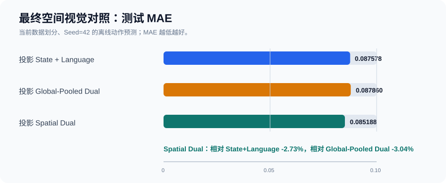
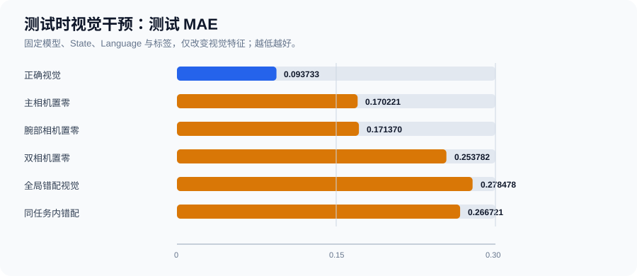
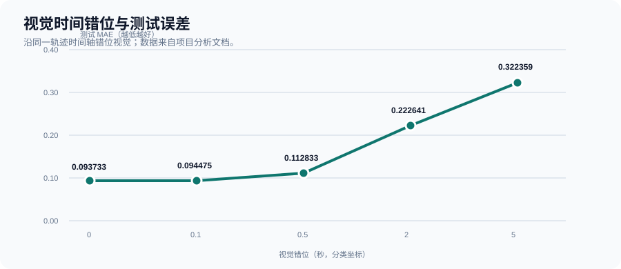

# Mini-VLA：多模态数据质检、干预诊断与空间视觉迭代

这是一个基于 LIBERO-10 的 Mini-VLA（Vision-Language-Action，视觉—语言—动作）离线实验档案。项目依次验证数据与字段可用性、任务与语言条件、双视觉干预，以及视觉表示的空间化改进。

## 面试摘要

| 维度 | 项目实验记录 |
|---|---|
| 数据规模 | 10 个任务、379 条轨迹、101,469 帧；2 路 RGB 视角、8 维状态、7 维动作 |
| 数据质检 | 核验任务覆盖、每条轨迹单一任务归属、任务到语言映射、数组对齐、NaN/Inf、特征方差与轨迹级切分 |
| 语言干预 | 固定模型，只改测试语言：移除语言 MAE +137.77%，错误语言平均 +156.80%，同义改写仅 +1.36% |
| 视觉诊断 | 双视觉置零 MAE +170.75%，全局错配视觉 +197.10%，5 秒视觉错位 +243.91% |
| 最终迭代 | 空间视觉模型 MAE 0.085188，较投影 State+Language 0.087578 改善 2.73%，较全局池化双视觉 0.087860 改善 3.04% |

MAE（Mean Absolute Error，平均绝对误差）越低越好。

## 项目结论

1. `task_index` 与自然语言不是同一字段：数据镜像中的任务元数据只提供任务编号，项目先建立任务编号到语言指令的映射，再进行语言条件实验。
2. 简单拼接和全局池化的视觉融合没有超过状态+语言基线；但测试时置零、错配和时间错位都会显著抬高误差，证明模型依赖帧级视觉状态。
3. 将 MobileNetV3-Small 的空间特征保留为 3×3 网格后，空间视觉版在当前单个随机种子实验中首次超过同架构 State+Language 与全局池化视觉对照。该结果支持空间信息有增量价值，但仍需多随机种子复验。

## 关键图表

图表根据项目实验输出中的聚合指标制作。仓库另附 15 份可公开的结果汇总 CSV；不附原始数据、模型或完整训练日志，不能在本仓库中端到端复现。







## 文档

- [简历项目经历](resume-project.md)
- [Mini-VLA 实验报告](docs/experiment-report.md)
- [数据与特征缓存质检](docs/data-qc.md)
- [语言条件与测试时干预](docs/language-conditioning.md)
- [证据范围与复现边界](docs/evidence-scope.md)
- [数据、模型来源与许可](docs/sources-and-licensing.md)
- [公开前检查](docs/release-checklist.md)
- [可公开的实验结果表](results/README.md)

## 项目路径

```text
字段与数据质检
  → Task ID 与语言条件控制
  → 固定模型的语言干预
  → 双视觉基线与反事实干预
  → 投影融合
  → 空间视觉表示
  → 复评
```

## 复现与公开范围

本仓库是面试展示用的实验档案，公开聚合指标、实验逻辑、图表与经筛选的结果 CSV；不包含原始 LIBERO 数据、特征缓存、语言缓存、模型权重、训练检查点、密钥或绝对路径。训练/评测代码和完整原始输出未随仓库公开，因此不能在此端到端复现。后续补充代码时应同步提供依赖版本、数据修订号、随机种子、完整命令与评测输出。

项目完成的是“质检—控制变量—反事实干预—问题定位—表示迭代—复评”的离线数据闭环；没有完成真实机器人失败后的补采、Dataset V2 与再训练闭环。
